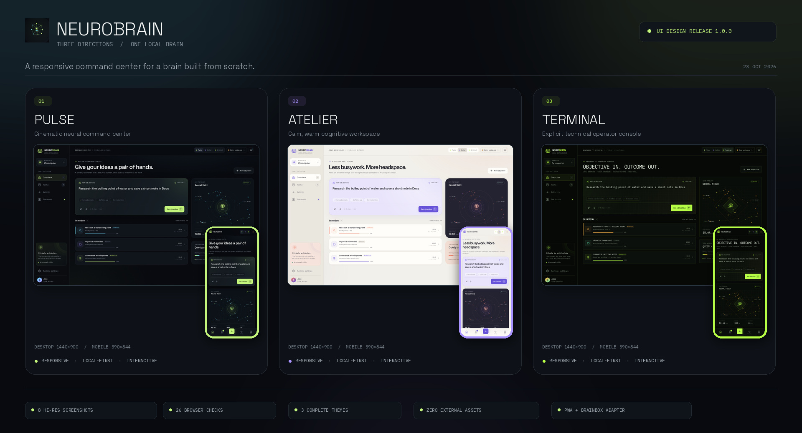

# Neurobrain UI — Design Release 1.0.0

Three production-minded, responsive UI directions for **Neurobrain / brainbox**, delivered as one installable Progressive Web App (PWA). The app works on desktop and mobile, uses no external runtime assets, and includes a small same-origin adapter for the existing local brainbox API.



## The three directions

| Concept | Character | Best fit |
|---|---|---|
| **Pulse** | Cinematic dark command center, acidic lime, glacial cyan, a living neural topology | The flagship product direction |
| **Atelier** | Warm parchment, ink, iris and coral; calm editorial spacing and softer geometry | A approachable everyday companion |
| **Terminal** | Phosphor green, amber, square geometry, mono type and explicit operator language | Developers and technical operators |

Use the three-dot concept switcher in the header to change direction. The choice persists locally.

## What works

- Responsive desktop, compact-desktop, and phone layouts
- Installable PWA manifest, icons, and offline static-asset cache
- Overview, objective queue, verified activity log, and model/evaluation views
- Interactive objective composer with suggestions and demo progress
- Task detail sheets with plans, observations, pause/resume, and undo-trail affordances
- Task filters, mobile bottom navigation, keyboard shortcuts, toasts, and dialogs
- Local runtime settings with a real `/health` connection check
- JavaScript adapter for brainbox `health`, `generate`, `score`, and `ground`
- Bundled variable fonts and icons; **no CDN, analytics, external images, or external AI calls**
- Honors reduced-motion preferences and includes visible keyboard focus states

### Keyboard shortcuts

- `Ctrl/Cmd + K`: focus the objective composer
- `Ctrl/Cmd + Enter`: run the composed demo objective
- `1` / `2` / `3` / `4`: Overview / Tasks / Activity / Brain (when not typing)

## Run it

No application build step or runtime npm dependencies are required. Python 3.10+ is enough:

```bash
cd ui
python3 serve.py
# open http://127.0.0.1:4173
```

On Windows, use `py serve.py` from this directory.

To connect the included proxy to the existing runtime, start brainbox first from the repository root:

```bash
brainbox serve
# Neurobrain UI, in another terminal:
cd ui && python3 serve.py
```

Then open **Runtime settings → Test**. The proxy forwards only the fixed routes `/health`, `/generate`, `/score`, and `/ground` to `http://127.0.0.1:8321`; brainbox itself remains loopback-only.

### Phone on the same network

```bash
cd ui
python3 serve.py --host 0.0.0.0 --port 4173
# On the phone: http://YOUR-PC-LAN-IP:4173
```

Use `0.0.0.0` **only on a trusted network**: it makes the UI and its fixed local API proxy reachable by other devices on that network. The default loopback mode is the safe desktop default. Browser installation/offline PWA features require localhost or HTTPS; an HTTP LAN page still runs as a responsive web app.

## Honest integration boundary

The current brainbox HTTP API exposes model operations, not a task-lifecycle endpoint. Therefore:

- **Task creation, progress, pause/resume, and activity entries in this design release are explicitly labeled demo simulations.**
- The runtime health check is real when a local brainbox is available.
- `Neurobrain.api` exposes real request methods for the four existing model routes.
- No UI element claims that a simulated desktop action really ran.

```js
const health = await Neurobrain.api.health();
const result = await Neurobrain.api.generate('def hello():\n', {maxTokens: 32});
const scores = await Neurobrain.api.score('The capital of France is', 5);
// const point = await Neurobrain.api.ground(pngBase64, 'click Save');
```

The next backend integration should add authenticated/local task endpoints for create, list, events, pause/resume, and undo rather than repurposing `/generate` as a fake task runner.

## Screenshots

Eight high-resolution captures are included in [`screenshots/`](screenshots/):

1. `01-pulse-desktop.png` — Pulse overview, 1440 × 900 CSS viewport
2. `02-pulse-mobile.png` — Pulse overview, 390 × 844 CSS viewport
3. `03-atelier-desktop.png` — Atelier overview
4. `04-atelier-mobile.png` — Atelier overview
5. `05-terminal-desktop.png` — Terminal overview
6. `06-terminal-mobile.png` — Terminal overview
7. `07-pulse-task-detail.png` — Observation timeline dialog
8. `08-atelier-mobile-brain.png` — Mobile model metrics and architecture

`00-design-overview.jpg` is the release contact sheet. PNG files are rendered at 1.5× on desktop and 2× on mobile. [`screenshots/manifest.json`](screenshots/manifest.json) records the exact capture matrix.

## Reproduce checks and captures

With the UI server running on port 4173:

```bash
cd ui
npm install
npx playwright install chromium   # first machine only
npm test                         # 26 desktop/mobile browser checks
npm run capture                  # regenerate the eight PNGs + manifest
```

On a minimal Linux installation, `npx playwright install-deps chromium` may be needed first. `BASE_URL` can point the scripts at another server.

## Source map

```text
ui/
├── index.html                 # Semantic application shell and inline SVG icon sprite
├── styles.css                 # Three design systems + responsive/reduced-motion rules
├── app.js                     # Interactions, demo state, neural canvas, brainbox adapter
├── serve.py                   # Dependency-free static server + fixed loopback API proxy
├── manifest.webmanifest       # Install metadata and shortcuts
├── sw.js                      # Offline cache for static app assets only
├── design/tokens.json         # Portable colors, typography, radii, breakpoints
├── assets/                    # Bundled fonts, licenses, and PWA icons
├── scripts/                   # Playwright checks and deterministic captures
└── screenshots/               # Release imagery
```

## Implementation notes

- The neural topology is deterministic, lightweight canvas artwork seeded for reproducible screenshots.
- The Brain view uses repository metrics with specific evaluation labels and a visible caveat; it does not turn them into a general capability claim.
- API requests are same-origin. The Python proxy refuses non-loopback brainbox URLs and does not proxy arbitrary paths.
- Service-worker caching deliberately excludes `/api/*` and all non-GET requests.
- Inter, Space Grotesk, and IBM Plex Mono are bundled with their license files in `assets/fonts/`.

See [`design/DIRECTIONS.md`](design/DIRECTIONS.md) for the design rationale and recommended product direction.
